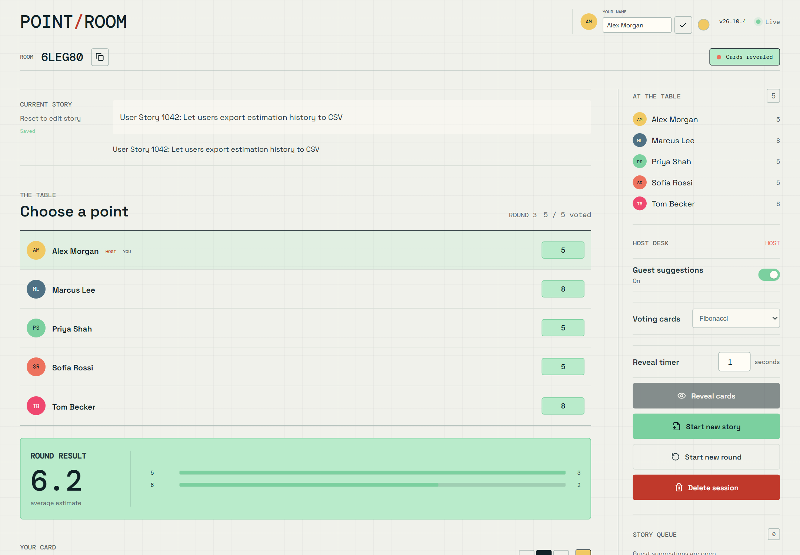
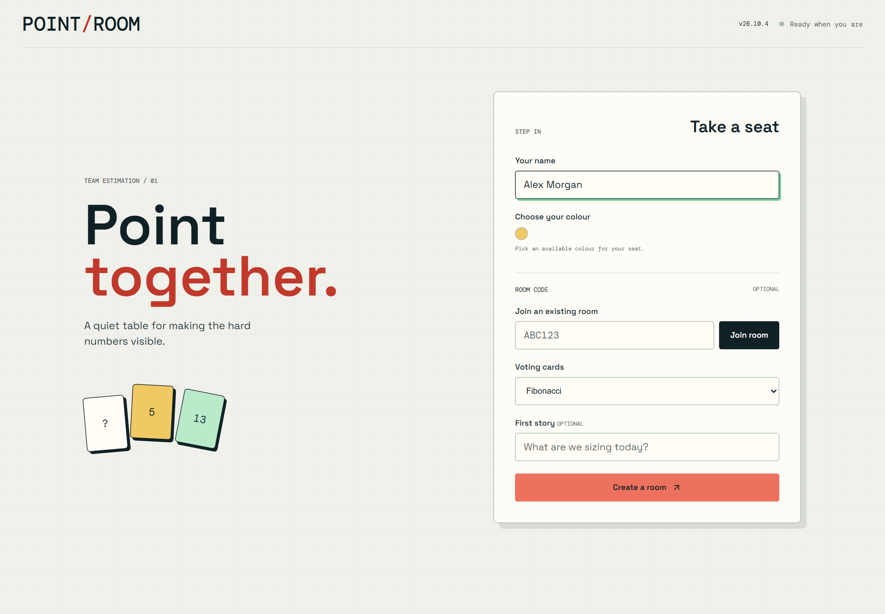
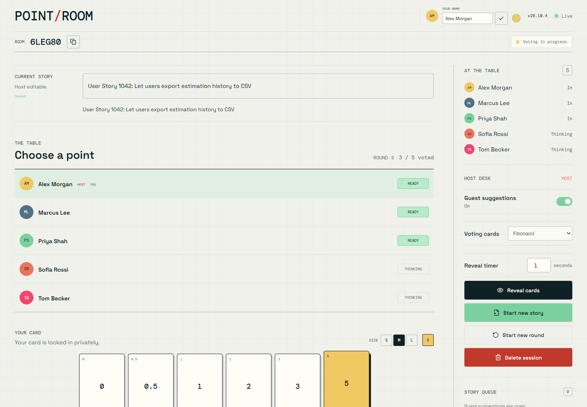
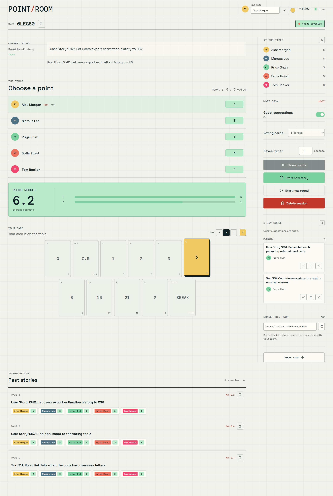
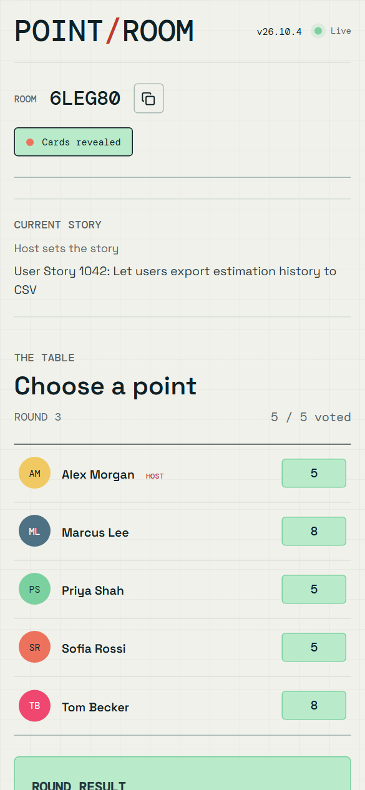

# Point Room

[](https://github.com/edsouthgate87/PointRoom/actions/workflows/ci.yml)

A self-hosted, real-time planning poker room for agile teams. Create a room,
share the link, and everyone votes privately before the cards are revealed
together. No accounts, no sign-up.



Current version: `26.10.6` (see [version.py](version.py)).

## Features

- **Instant rooms.** Enter a name, create a room, and share the six-character
  code or link. Teammates join with just a display name.
- **Private voting.** Until the host reveals, everyone only sees who has voted.
  Click your card again to take your vote back.
- **Clear results.** After the reveal countdown, all cards, the average, and the
  vote distribution are shown to everyone.
- **Choice of decks.** Fibonacci, SAFe modified Fibonacci, or T-shirt sizes.
  The host can switch decks between rounds.
- **Story queue.** The host can let guests suggest stories, then use one now,
  queue it for later, or dismiss it.
- **Session history.** Every story is kept with its votes and average. The host
  can remove a single story or delete the whole session.
- **Azure DevOps links.** References such as `User Story 1234` or `Bug 42` can
  link straight to your work items.
- **Works on phones.** The layout adapts to small screens.
- **Persistent rooms.** Rooms survive restarts and are cleaned up after 30 days
  of inactivity.

| Create a room | Vote in private |
| --- | --- |
|  |  |

| Story queue and history | Mobile |
| --- | --- |
|  |  |

## Quick start with Docker

```bash
docker build --tag pointroom:local .
docker volume create pointroom-data
docker run --detach --name pointroom --publish 5000:5000 \
  --volume pointroom-data:/app/data pointroom:local
```

Open <http://localhost:5000>. The named volume keeps rooms across container
restarts.

To let other people on your network join, set `PUBLIC_BASE_URL` to an address
they can reach, for example `--env PUBLIC_BASE_URL=http://192.168.1.25:5000`,
so the share links point to the right place.

## Run from source

Requires Python 3.12 or later.

```bash
python -m venv .venv
# Windows: .\.venv\Scripts\Activate.ps1
# macOS/Linux: source .venv/bin/activate
python -m pip install -r requirements.txt
python app.py
```

Open <http://localhost:5000>. The server listens on all interfaces, so to
share it on your network set `PUBLIC_BASE_URL` to the machine's reachable
address and allow TCP port 5000 through your firewall. Set
`POINTROOM_HOST=127.0.0.1` to keep it local.

## Configuration

All settings are environment variables. The most useful ones are:

| Variable | Default | Purpose |
| --- | --- | --- |
| `PUBLIC_BASE_URL` | request host | External address used in share links, such as `https://pointroom.example.com`. |
| `POINTROOM_HOST` / `POINTROOM_PORT` | `0.0.0.0` / `5000` | Address for `python app.py`. The Docker image always listens on `0.0.0.0:5000`. |
| `POINTROOM_REQUIRE_HTTPS` | `0` | Redirect HTTP to HTTPS and send HSTS. Requires an `https://` `PUBLIC_BASE_URL`. |
| `POINTROOM_TRUST_PROXY` | `0` | Trust `X-Forwarded-*` headers. Enable only behind a trusted reverse proxy. |
| `POINTROOM_ALLOWED_ORIGINS` | same origin | Comma-separated extra origins allowed to open Socket.IO connections. |
| `POINTROOM_DATABASE_PATH` | `data/pointroom.sqlite3` | SQLite database location. |
| `POINTROOM_DATABASE_URL` | unset | PostgreSQL connection string. Overrides SQLite. |
| `POINTROOM_RETENTION_DAYS` | `30` | Days of inactivity before a room is deleted. |
| `POINTROOM_RETENTION_CLEANUP_ENABLED` | `0` (`1` in Docker) | Run the background cleanup worker. |
| `POINTROOM_RATE_LIMITING_ENABLED` | `1` | Per-client limits on room creation, joins, votes, and suggestions. |
| `POINTROOM_MAX_ACTIVE_ROOMS` | `1000` | Maximum rooms held in memory. |
| `POINTROOM_MAX_SOCKET_CONNECTIONS` | `500` | Maximum concurrent connections. |
| `POINTROOM_LOG_LEVEL` | `INFO` | JSON log level. `INFO` includes audit events. |
| `ADO_WORK_ITEM_BASE_URL` | unset | Azure DevOps work item URL prefix, such as `https://dev.azure.com/<org>/<project>/_workitems/edit/`. |

Rate limits for individual events can also be tuned; see `create_app` in
[app.py](app.py) for the full list.

## Deploying with HTTPS

For anything beyond a quick trial, put Point Room behind a reverse proxy that
terminates HTTPS and forwards WebSocket traffic, then set:

```text
POINTROOM_REQUIRE_HTTPS=1
POINTROOM_TRUST_PROXY=1
PUBLIC_BASE_URL=https://pointroom.example.com
POINTROOM_ALLOWED_ORIGINS=https://pointroom.example.com
```

Point Room has no user accounts, so keep it on a private network or behind an
authenticating proxy.

[docs/deployment.md](docs/deployment.md) has a complete guide, including Caddy
examples for public and internal host names, PostgreSQL with Docker Compose,
health checks, updates, and backups.

## Good to know

- Run **one** process. Room state and Socket.IO coordination are in-process,
  so multiple workers or replicas are not supported yet.
- The database stores room codes, hashed host tokens, names, stories, and
  votes. Protect it and its backups.
- Participant credentials live in the browser tab's session storage. The host
  credential is kept for 12 hours so the host can reopen the room in a new
  tab. It is never included in the room link.
- `GET /health` returns `200` when the database is reachable and is used by
  the Docker health check.
- Run `python maintenance.py` to remove expired rooms on demand.

## Development

```bash
python -m pytest -q
```

See [CONTRIBUTING.md](CONTRIBUTING.md) for the versioning rule enforced by CI
and how to run the load test.

## License

Copyright 2026 edsouthgate87.

Licensed under the [Apache License, Version 2.0](LICENSE).
